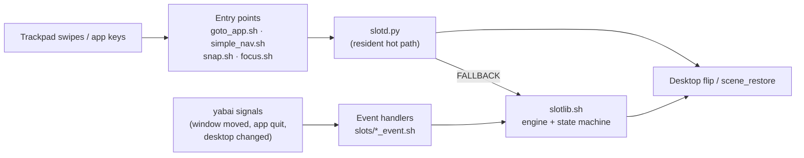

# Slots

**A window manager for macOS built on [yabai](https://github.com/koekeishiya/yabai): every app gets a fixed place, and a trackpad swipe or one key flips between screen layouts in about 0.13 s.**

I work across Fusion, 3ds Max, Photoshop, Chrome and Claude all day on one screen. macOS's own desktops forget where things were and Mission Control is slow, so I built a layer on top: a **slot** is a remembered layout (one app full screen, or two side by side, or quarters), and slots sit on a sequence or a 3×3 grid you swipe through. Pressing an app's key jumps to the slot that holds it, or makes it one.

---

## Highlights

| | What it does |
|---|---|
| **Slots, not windows** | Each slot records which apps are in it, at which of 7 tile positions (full, halves, quarters) and in what stacking order. Window classes are decided by **live geometry** (a window matching a tile is snapped, anything else is a floater), not a registry that can drift. |
| **The coverage rule** | One invariant keeps state honest: a slot only records what is visibly on top. Placing an app removes every member it covers, and leaving a slot re-syncs it to what's actually on screen. |
| **Native-desktop mode** | Each slot is bound to a real macOS desktop, so a switch is a desktop flip. Windows shared between slots (Claude beside Safari *and* beside Chrome) travel ahead of the flip, and macOS's own switches (Dock, ⌘-Tab) are followed. |
| **slotd** (`slots/slotd.py`) | A resident Python daemon for the hot path: state read and written in-process (~1 ms) and yabai spoken to over its socket (~2 ms), instead of ~150 ms of shell start-up and forks. Anything it doesn't handle answers FALLBACK *before touching anything*, so the shell engine stays authoritative. |
| **Atomic reveal** (`bin/scene_restore.m`) | The single-desktop mode freezes the screen, positions every member through Accessibility, re-stacks covering windows, then unfreezes, so a switch never shows half a layout. |
| **Grid** (`slots/grid.py`) | Slots laid out on a 3×3 grid, swiped in four directions; a position can hold alternatives, toggled in place. |
| **Paired layouts** | Apps that belong together (e.g. a browser with Claude beside it) open as a pair automatically. |
| **Robustness** | Busy apps (Fusion can stall Accessibility for 15 s+) are worked around by reading the window server directly (`bin/space_query.m`) and waiting out a busy yabai; one off switch makes every entry point fall back to plain `open -a`. |
| **Tests** | `slots/test_slots.sh` dry-runs the engine against ~190 scenario checks; `slots/test_slotd.sh` diffs the Python daemon against the shell engine op by op; `test_invariants.sh` fuzzes long random sequences of real operations and checks the invariants after every step. |

## How it fits together



## Repository layout

```
slots/
├── MODEL.md          The behavioural spec: concepts, coverage rule, every operation
├── slotlib.sh        The engine (state in /tmp/slot_*)
├── slotd.py          Resident port of the switch path
├── grid.py           3×3 grid of fixed slots
├── *_event.sh        yabai signal handlers
└── test_*.sh         Dry-run suites
bin/                  Objective-C / C helpers: scene_restore, space_query, win_list, activate_app, slotc (socket client)…
config/               App list + pairings (settings.json), grid, yabairc
*.sh                  Entry points bound to keys and gestures
ARCHITECTURE.md       Map of the whole system
```

Start with **[slots/MODEL.md](slots/MODEL.md)** for how it behaves, and **[ARCHITECTURE.md](ARCHITECTURE.md)** for how the pieces connect.

## Notes

This is a working snapshot of a personal setup, not a packaged product. It needs yabai with its scripting addition, Accessibility permission for the helpers, and paths from the system it was built in. Keys and gestures come from the companion [trackpad-gestures](https://github.com/JoshCallis/trackpad-gestures) remapper.
